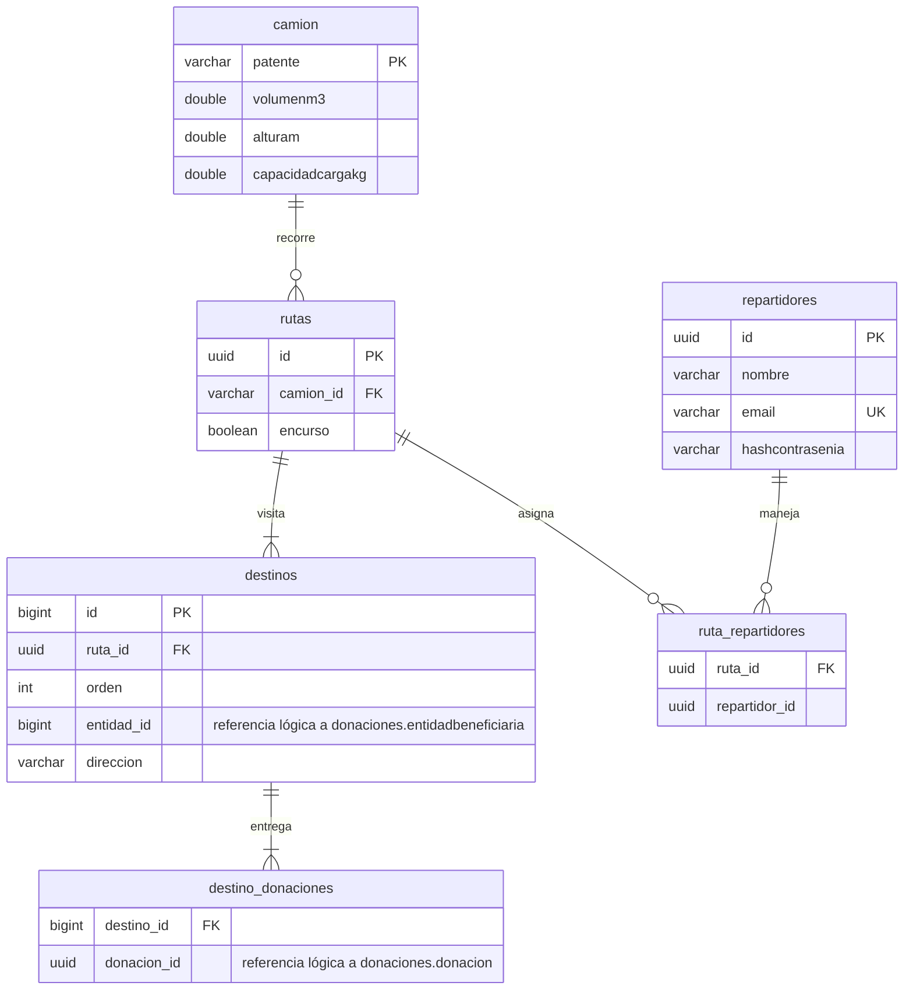

# Diagrama Entidad-Relación Físico (DER)

Modelo relacional real de DonaTrack (entrega 4). Las tablas y columnas son las que genera Hibernate
(`hbm2ddl.auto=update`) a partir de las entidades JPA. Se relevaron del Postgres de despliegue con
`information_schema`, no se transcribieron a mano.

Cada microservicio tiene su **propio esquema** en la misma base: `donaciones` y `logistica`. Entre
esquemas no hay claves foráneas. Logística guarda el id de la entidad y de cada donación como
**referencia lógica** y los resuelve consultando a donaciones (ver
[Contrato-microservicios-donacion-logistica.md](Contrato-microservicios-donacion-logistica.md)).

## Esquema `donaciones`

```mermaid
erDiagram
    donante {
        uuid id PK
        varchar documento "DNI, CUIT, ..."
        varchar numdocumento
        bigint contacto_predeterminado_id FK
    }
    personahumana {
        uuid id PK, FK
        varchar nombre
        varchar apellido
        varchar genero
        varchar direccion
    }
    personajejuridica {
        uuid id PK, FK
        varchar razonsocial
        varchar tipoorganizacion
        varchar rubro
    }
    representante {
        bigint id PK
        uuid donante_id FK
        varchar nombre
        varchar apellido
    }
    mediodecontacto {
        bigint id PK
        uuid donante_id FK
        varchar contacto
    }
    correoelectronico {
        bigint id PK, FK
        bigint entidad_id FK "correos de una entidad"
    }
    sms {
        bigint id PK, FK
    }
    whatsapp {
        bigint id PK, FK
    }

    entidadbeneficiaria {
        bigint id PK
        varchar razonsocial
        varchar direccion
        varchar telefono
        double latitud "geocodificada"
        double longitud "geocodificada"
        boolean ubicacionintentada
    }
    necesidad {
        uuid id PK
        varchar dtype "Necesidad | NecesidadRecurrente"
        bigint entidad_id FK "extraordinarias"
        bigint entidad_recurrente_id FK "recurrentes"
        bigint subcategoria_id FK
        double cantidadobjetivo
        double cantidadrecibida
        varchar unidad
        varchar periodo "SEMANAL | MENSUAL"
        varchar descripcion
    }
    subcategoria {
        bigint id PK
        varchar nombre UK
        varchar categoria "ALIMENTO | VESTIMENTA | MOBILIARIO"
    }

    donacion {
        uuid id PK
        uuid donante_id FK
        bigint entidad_id FK
        varchar estado
        varchar idcamion "patente, referencia lógica a logística"
    }
    bien {
        bigint id PK
        uuid donacion_id FK
        bigint subcategoria_id FK
        varchar descripcion
        double cantidad
        varchar unidad
        date fechavencimiento
        varchar estadodeuso
        varchar foto
    }
    historialestado {
        bigint id PK
        uuid donacion_id FK
        int orden
        varchar estadoalcanzado
        timestamp fecha
        varchar justificacion
    }
    donacion_fotos {
        uuid donacion_id FK
        varchar foto "URL pública (Supabase Storage)"
    }

    propuestadeasignacion {
        uuid id PK
        uuid donacion_id FK, UK
        boolean pendiente
    }
    propuesta_candidatos {
        uuid propuesta_id PK, FK
        int orden PK
        bigint entidad_id FK
        int puntaje
    }

    usuarios {
        uuid id PK
        varchar email UK
        varchar passwordhash "BCrypt, o marcador de cuenta a activar"
        uuid donanteid "referencia al donante"
        bigint entidadid "referencia a la entidad"
    }
    usuario_roles {
        uuid usuario_id FK
        varchar rol "ADMIN | DONANTE | BENEFICIARIO"
    }
    aviso_bandeja {
        uuid id PK
        uuid donanteid "titular donante"
        bigint entidadid "titular entidad"
        varchar mensaje
        timestamp fecha
        boolean leido
    }

    donante ||--o| personahumana : "es"
    donante ||--o| personajejuridica : "es"
    personajejuridica ||--o{ representante : "tiene"
    donante ||--o{ mediodecontacto : "se contacta por"
    donante }o--o| mediodecontacto : "prefiere"
    mediodecontacto ||--o| correoelectronico : "es"
    mediodecontacto ||--o| sms : "es"
    mediodecontacto ||--o| whatsapp : "es"
    entidadbeneficiaria ||--o{ correoelectronico : "recibe avisos en"

    entidadbeneficiaria ||--o{ necesidad : "declara"
    subcategoria ||--o{ necesidad : "clasifica"

    donante ||--o{ donacion : "realiza"
    entidadbeneficiaria ||--o{ donacion : "recibe"
    donacion ||--|{ bien : "contiene"
    subcategoria ||--o{ bien : "clasifica"
    donacion ||--o{ historialestado : "registra"
    donacion ||--o{ donacion_fotos : "se confirma con"

    donacion ||--o| propuestadeasignacion : "se propone en"
    propuestadeasignacion ||--o{ propuesta_candidatos : "rankea"
    entidadbeneficiaria ||--o{ propuesta_candidatos : "es candidata en"

    usuarios ||--|{ usuario_roles : "tiene"
```

`usuarios.donanteid`, `usuarios.entidadid`, `aviso_bandeja.donanteid` y `aviso_bandeja.entidadid`
son referencias sin clave foránea, a propósito. La cuenta y la bandeja pertenecen a la capa web y
de seguridad: borrar o reimportar un donante no tiene que arrastrar la tabla de usuarios, ni al
revés.

## Esquema `logistica`

La última posición de cada camión (`MonitorRutas`) vive en memoria y no se persiste: es un dato
volátil que el GPS vuelve a informar a los pocos segundos.

## Cambios de la entrega 4

| Cambio | Motivo |
|---|---|
| `aviso_bandeja` (nueva) | Bandeja web de avisos de donantes y entidades (vistas #49 y #54). |
| `entidadbeneficiaria.latitud`, `longitud`, `ubicacionintentada` | Ubicación geocodificada para los mapas (#43, #50 y #55). |
| `donacion_fotos.foto` guarda URLs de Supabase Storage | Fotos de la confirmación de recepción (#53). |
| `usuarios.passwordhash` admite un marcador de "cuenta a activar" | Cuentas creadas por la importación CSV (#60). |
| `personahumana.edad` se quitó del modelo | Ver Justificaciones 4.8. La columna queda en bases ya creadas, porque `update` no borra columnas. Se elimina con `ALTER TABLE donaciones.personahumana DROP COLUMN edad;`. |
