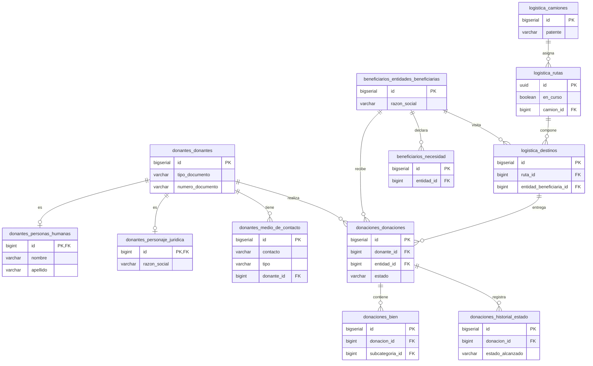

# Diagrama Entidad-Relación Físico (DER)

Este diagrama representa el modelo relacional físico en la base de datos, reflejando la decisión arquitectónica de aislar las tablas en esquemas separados (`donantes`, `beneficiarios`, `donaciones`, `logistica`).

