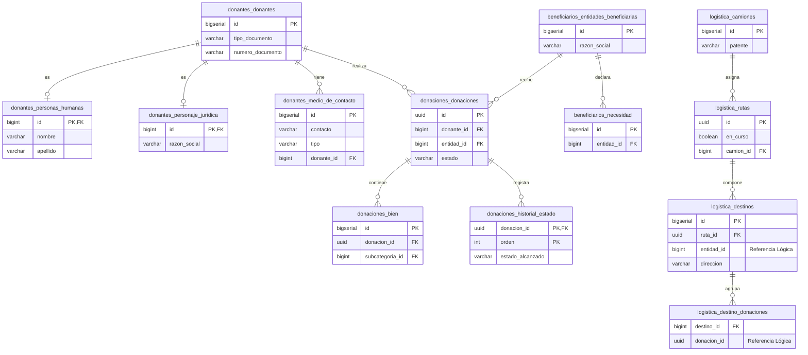

# Diagrama Entidad-Relación Físico (DER)

Este diagrama representa el modelo relacional. Como que el sistema fue separado en dos microservicios (`Donaciones` y `Logística`), los esquemas pertenecen a bases de datos independientes. Las referencias entre ambos servicios se realizan mediante IDs lógicos a través de la API.

