# DonaTrack — Modelo del dominio por requerimiento

Diagramas de clases (Mermaid) del dominio de DonaTrack, uno por requerimiento de los enunciados [`enunciado-1.md`](./enunciado/enunciado-1.md) y [`enunciado-2.md`](./enunciado/enunciado-2.md), y la arquitectura de la [entrega 4](#entrega-4--arquitectura-y-cambios-del-dominio).

Cada diagrama es el **fragmento mínimo del dominio** que cumple ese requerimiento; el diagrama completo está en [`diagrama-clases-dominio.mermaid`](./diagrama-clases-dominio.mermaid).

> Piezas fuera del dominio (repositorios, servicios, schedulers) se etiquetan `<<infraestructura>>` y solo se incluyen cuando el requerimiento las necesita.

## Entrega 1 — Requerimientos de dominio

### R1 — Gestión de personas donantes

**Decisión:** `Donante` es una clase abstracta con dos especializaciones (`PersonaHumana` y `PersonajeJuridica`) porque cada tipo registra datos distintos. Los medios de contacto forman una jerarquía (`MedioDeContacto` con email, WhatsApp y SMS) que permite sumar canales sin tocar `Donante`.


### R2 — Gestión de las donaciones resultantes

**Decisión:** La carga única (`CargaDonacion`) genera varias donaciones separando automáticamente por `SegmentacionKey` (subcategoría + vencimiento + estado de uso). Cada `Donacion` queda ligada a una única subcategoría, la unidad mínima de asignación.


### R3 — Gestión de entidades beneficiarias y sus necesidades

**Decisión:** `EntidadBeneficiaria` mantiene dos colecciones separadas (`Necesidad` extraordinaria y `NecesidadRecurrente`). `Necesidad` modela la satisfacción parcial por cantidades; la recurrente agrega el período (`TipoPeriodo`). `RecepcionDonacion` registra qué donaciones la cubren.


### R4 — Trazabilidad de los estados de las donaciones

**Decisión:** Patrón **State**: `Donacion` delega las transiciones en `EstadoDonacion` (abstracto) con 7 estados concretos. Cada cambio queda registrado en `HistorialEstado` (fecha, estado, justificación) para auditoría.


### R5 — Importación masiva de donantes en CSV

**Decisión:** `ImportadorDonantesCsv` parsea a `DonanteCsv` y mapea a donante humano o jurídico. El upsert por email (`DonantesRepository.upsert`) resuelve la regla del enunciado: "si existe se actualiza con `merge`, si no se crea".


## Entrega 1 — Alcance

### Notificaciones — Primera iteración

**Decisión:** Doble dispatch: `MedioDeContacto.aceptar(Notificador)` delega el envío en el `Notificador` (interfaz), simulado por `NotificadorSimulado`. `Notificacion` guarda destinatario, mensaje y estado (PENDIENTE/ENVIADA/FALLIDA).


## Entrega 2 — Requerimientos de dominio

### R1 — Trazabilidad de los estados de las donaciones

**Decisión:** Mismo fragmento que el R4 de la Entrega 1 (patrón State + `HistorialEstado`).

### R2 — Notificaciones por distintos medios ante eventos

**Decisión:** cada evento implementa la interfaz `EventoNotificable` (6 implementaciones) y genera sus `Notificacion` en `generarNotificaciones()`. Las transiciones de `EstadoDonacion` publican su evento al ocurrir en un `PublicadorDeEventos`; quien transiciona entrega el publicador y no arma notificaciones a mano. Los casos de uso transaccionales usan un `PublicadorDiferido`, que retiene los eventos y los envía con `ServicioNotificaciones` recién después del commit: si la transacción se revierte, no sale ningún aviso. Es interfaz y no clase abstracta porque no hay comportamiento compartido: `publicar` solo necesita tratar a todos los eventos por igual. La `Notificacion` es solo destinatario y mensaje: el comprobante de entrega (fecha y patente) y el enlace al mapa viajan en el texto, porque nadie consume un payload estructurado. Los envíos no se guardan; `NotificadorPorCanal` registra en el log los que fallan. `Donante` y `EntidadBeneficiaria` implementan `Notificable`.


### R3 — Ejecución asíncrona de los algoritmos de asignación

**Decisión:** Strategy: `AlgoritmoMatchmaking` con dos implementaciones intercambiables. Un planificador externo (cronjob) invoca `MatchmakingRunner` una vez por día (baja carga); el runner ejecuta `ServicioMatchmakingDonaciones`, que genera `PropuestaDeAsignacion` con la intersección de las ejecuciones —o su unión cuando no hay coincidencias— para confirmación administrativa (reificación).


### R4 — Operaciones vía API REST

**Decisión:** El código actual es dominio puro (sin capa REST todavía). El fragmento muestra los agregados que la API debe exponer y las operaciones del enunciado; *los controladores quedan pendientes*.


### R5 — Planes de rutas en horarios de baja carga (componente externo)

**Decisión:** Port hacia el componente externo: `PlanificadorRutas` recibe `LoteDonaciones` y devuelve `LoteId`. El resultado (`ResultadoPlanificacion`) se materializa en el agregado `Ruta` (camión + destinos). `ServicioPlanificacionRutas` orquesta.


### R6 — Choferes informan el comienzo de su ruta

**Decisión:** `Ruta.iniciar()` marca la ruta en curso y las donaciones de sus destinos pasan a "En traslado" (`Donacion.iniciarTraslado`).


### R7 — Monitoreo en tiempo real de los camiones

**Decisión:** `MonitorRutas` procesa `LecturaPosicion` (camión, coordenada, velocidad, timestamp), descarta lecturas futuras y correlaciona con la ruta activa. El inicio de ruta notifica con el enlace al mapa en el mensaje.


### R8 — Gestión de la recepción de la entrega

**Decisión:** `EntidadBeneficiaria.registrarRecepcion` crea `RecepcionDonacion` y actualiza las necesidades. La confirmación deja la donación "Entregada" (con camión responsable) o "Entrega fallida" con justificación y retorno al depósito.


## Entrega 2 — Requerimientos de implementación

### Impl 1 — URL de callback del planificador

**Decisión:** El componente externo llama de vuelta a `ServicioPlanificacionRutas.procesarResultado`, que crea y persiste las `Ruta` y pasa las donaciones asignadas a "Lista para entregar".


### Impl 2 — Solicitudes al proveedor en lotes (máx. 100)

**Decisión:** `ServicioPlanificacionRutas.partirEnLotes` arma lotes de hasta 100 donaciones y `LoteDonaciones` valida el tope como invariante en su constructor (record).


### Impl 3 — Replanificación de donaciones sin asignar

**Decisión:** Las donaciones que el planificador no asigna permanecen en "Asignación realizada" y entran a la siguiente ejecución de planificación.


## Entrega 4 — Arquitectura y cambios del dominio

### Arquitectura

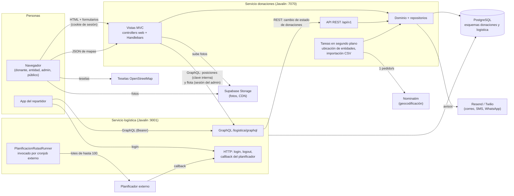

* **Cliente liviano:** todas las vistas se renderizan en donaciones (MVC con Handlebars). El
  navegador solo ejecuta JavaScript para los mapas (`mapas.js`, con Leaflet) y para tres secciones
  de administración heredadas (`panel.js`).
* **Logística por GraphQL:** donaciones la consulta para las posiciones de los camiones, con la
  clave interna, y para administrar la flota, con la sesión de la persona administradora (ver
  [Justificaciones 1.3 y 4.6](Justificaciones.md)).
* **Servicios externos detrás de puertos**, con un doble para pruebas y desarrollo:
  * `AlmacenFotos`: Supabase o disco local.
  * `Geocodificador`: Nominatim.
  * `Notificador`: Resend y Twilio, o el simulado si no hay credenciales.
  * `PosicionesCamiones` y `FlotaLogistica`: logística por GraphQL.

### Cambios del dominio

El diagrama completo está en [`diagrama-clases-dominio.mermaid`](./diagrama-clases-dominio.mermaid)
y el modelo relacional en [`DER-fisico.md`](./DER-fisico.md).

| Cambio | Para qué vista |
|---|---|
| `Notificacion` conoce a su **titular** (`Notificable`). `BandejaNotificaciones` y `AvisoBandeja` guardan los avisos de cada donante y cada entidad. | Avisos de donante y entidad (#49, #54) |
| `EntidadBeneficiaria` tiene `latitud` y `longitud`, que completa `UbicadorEntidades` con un `Geocodificador`. | Mapas (#43, #50, #55) |
| `Donacion.fotos` guarda las URLs públicas de las fotos de recepción. | Confirmación con fotos (#53) |
| `Usuario` admite una cuenta **pendiente de activación**, que crea la importación CSV y la persona activa con su documento. | Importación de donantes (#60) |
| `PersonaHumana` ya no tiene `edad`. | Ver [Justificaciones 4.8](Justificaciones.md) |

### Vistas

El inventario de pantallas, con capturas y el sistema de diseño, está en
[`SistemaDeDiseno.md`](./SistemaDeDiseno.md).
